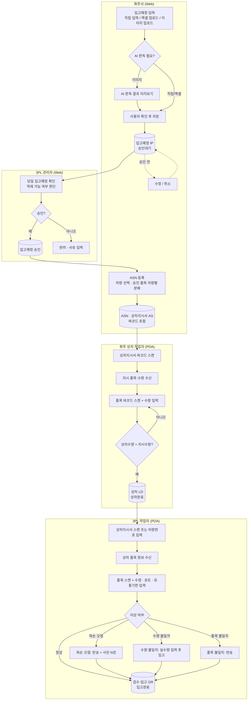

# 01. 업무 프로세스 플로우

> 3PL 입고관리 시스템의 업무 흐름입니다. 범위는 화주사의 입고예정 등록부터 3PL 센터 입고완료까지입니다.
> 원본 요구사항은 기획자 정리본(etc/plan.md)이며, 기준정보 정의는 [04-master-data.md](04-master-data.md)를 참고합니다.

## 1. 참여자와 매체

| 참여자 | 설명 | 사용 매체 |
|---|---|---|
| 화주 사용자 | 화주사 담당자. 입고예정과 ASN을 등록하고 조회 | Web |
| 화주 상차 작업자 | 화주사 출고지에서 차량 상차를 수행 | PDA |
| 3PL 관리자·운영자 | 입고 승인, 현황 관리, 기준정보 관리 | Web |
| 3PL 작업자 | 센터에서 입고 검수를 수행 | PDA |
| AI 판독 | 카톡·메일 이미지에서 품목·수량을 추출 | 시스템 |

## 2. 전체 흐름

## 3. 단계별 상세

### 3.1 입고예정 등록 (화주, Web)
| 항목 | 내용 |
|---|---|
| 목적 | 당일 또는 익일에 입고할 품목과 수량을 등록 |
| 등록 방식 | ① 품목 찾기로 직접 입력 ② 엑셀 업로드 ③ 카톡·메일 같은 텍스트 이미지를 업로드하면 AI가 판독 |
| 처리 | 어느 방식이든 **미리보기에서 사용자가 확인한 뒤 저장**. 품목은 화주 품목코드나 바코드로 기준정보와 매칭 |
| 결과 | 입고예정 전표(IP) 생성, 상태는 **승인대기** |
| 규칙 | 승인대기 상태에서만 수정·취소 가능. 품목은 해당 화주의 사용 중인 품목만 허용 |

### 3.2 입고 승인 (3PL 관리자, Web)
| 항목 | 내용 |
|---|---|
| 목적 | 화주사의 당일 입고예정을 보고 센터 적재 가능 여부를 판단 |
| 처리 | 승인대기 건을 **승인**(승인수량 확정) 또는 **반려**(사유 입력) |
| 결과 | 승인 상태가 되면 당일 입고예정분으로 최종 확정 |
| 승인 방식 | **전표 단위 최종 승인 + 품목 라인별 검토**. 라인별 승인수량은 0 ~ 예정수량 범위에서 조정하고, 예정보다 적게 승인하면 조정 사유 필수. 라인 승인수량이 모두 0이면 승인 대신 반려 |
| 권한 | 3PL 관리자·운영자 (작업자는 승인 불가) |
| 규칙 | 승인·반려 후에는 화주가 수정·취소할 수 없음. 반려 사유는 화주에게 표시 |

### 3.3 ASN 등록 (화주, Web)
| 항목 | 내용 |
|---|---|
| 목적 | 승인된 당일 입고예정(화주 입장에서는 출고예정)을 **차량별로 분배** |
| 처리 | 차량을 선택하고, 승인 품목의 잔여 수량 범위 안에서 차량별 수량 배정 |
| 결과 | ASN 전표(AS)와 차량별 **상차지시서** 출력(ASN 번호 바코드 포함) |
| 규칙 | 입고예정 1건 단위가 아니라 당일 승인분 전체에서 배정. 같은 품목 라인의 차량별 배정 수량 합계는 승인수량 이하 |

### 3.4 차량별 상차 등록 (화주 상차 작업자, PDA)
| 순서 | 작업 |
|---|---|
| 1 | 상차지시서 바코드 리딩 |
| 2 | 상차지시 품목·수량 정보 수신 |
| 3 | 상차하면서 품목 바코드 스캔 후 수량 입력 |
| 4 | 상차 등록 시 정합성 체크: **상차 수량 = 지시 수량**인 경우에만 상차완료 |

| 항목 | 4단계 확정 내용 |
|---|---|
| 수량 입력 | 스캔마다 수량 입력(기본 1) 후 **누적**. 잘못 넣으면 품목별 상차수량을 정정(차이를 정정 이력으로 기록) |
| 바코드 없음·훼손 | 상차지시 품목 목록에서 직접 선택해 수량 추가(입력 방식 '수동'으로 기록) |
| 이력 | 스캔·수동·정정 1건마다 `loading_scans`에 남김 |
| 화면 | 사이드바 없는 PDA 전용 화면(`/pda`). 스캔칸 자동 포커스, 화면 키보드는 필요할 때만 켬 |
| ASN 대상 | 같은 날짜의 승인분만 배정(ASN 일자 = 입고예정일). 여러 입고예정 전표의 품목을 한 차량에 배정 가능 |
| ASN 수정·취소 | 화주사만, 상차 시작 전까지. 3PL은 조회·상차지시서 재출력만 |
| 상차지시서 | A4 1장: ASN 번호 바코드(Code128), 화주사·센터·차량·기사·일자, 품목별 코드·품명·규격·바코드·단위·지시수량·확인란 |

### 3.5 입고예정 조회 (화주·3PL, Web)
| 조회 | 기준 | 주요 항목 |
|---|---|---|
| 조회 ① | 입고예정 승인 기준, 품목별 | 품목, 예정수량, 승인수량, ASN 배정수량, 미배정수량 |
| 조회 ② | ASN·상차 기준, 차량별 | 차량, ASN 번호, 지시수량, 상차수량, 입고수량 |
| 공통 | 당일 입고분 기준 입고현황 | 예정 대비 입고 진행률, 이상 건수 |

### 3.6 입고 검수·등록 (3PL 작업자, PDA)
| 순서 | 작업 |
|---|---|
| 1 | 상차지시서 바코드 스캔 또는 차량번호 입력 (상차지시서가 거래명세서를 대신함) |
| 2 | 해당 차량으로 상차 등록된 품목 정보 수신 |
| 3 | 품목 바코드 스캔 후 수량 입력. 로트·유통기한 관리 품목은 로트번호·유통기한도 입력 |
| 4 | 이상 발생 시 아래 표에 따라 처리 |
| 5 | 검수 완료 → 입고완료 |

| 이상 유형 | 처리 | 기록 |
|---|---|---|
| 훼손·오염 | 반송 | 품목 스캔, 반송 수량, 반송 사유, **사진 N장** |
| 수량 불일치 | 실제 수량을 정확히 입력한 뒤 입고 처리 | 입고 수량, 차이 수량(자동 계산) |
| 품목 불일치 | 반송 | 스캔한 실물 바코드, 반송 수량, 사유 |

## 4. 상태 요약

| 전표 | 상태 흐름 |
|---|---|
| 입고예정 IP | 승인대기 → 승인 / 반려 / 취소 |
| ASN AS | 등록 → 상차완료 → 검수중 → 입고완료 / 취소 |
| 상차 LD | 상차중 → 상차완료 |
| 검수 GR | 검수중 → 입고완료 |

상세 상태 다이어그램과 정합성 규칙은 [02-document-flow.md](02-document-flow.md)를 참고합니다.
