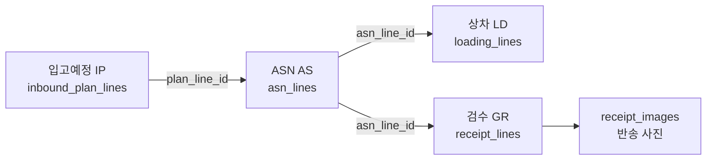
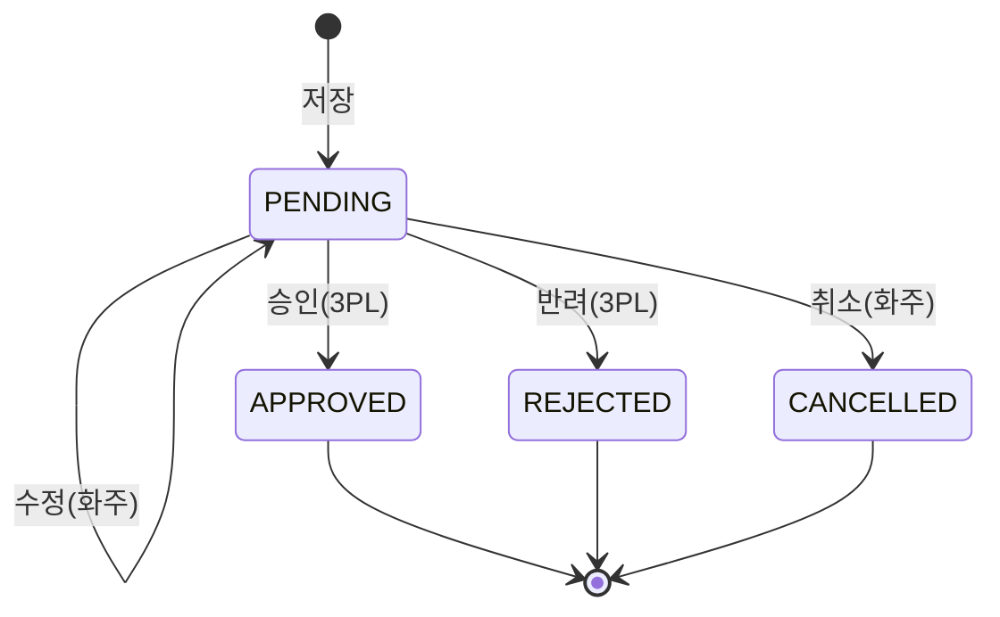
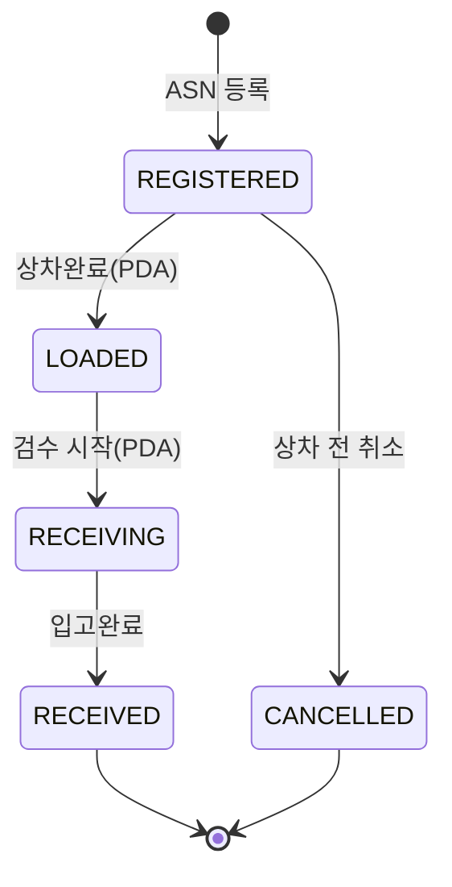
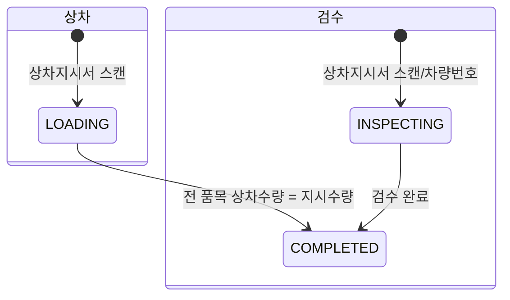

# 02. 전표 흐름과 정합성

> ERP처럼 전표 흐름을 앞뒤로 추적할 수 있도록 설계합니다. 모든 전표 라인은 바로 앞 단계 전표 라인을 FK로 참조합니다.

## 1. 전표 체계

| 전표 | 접두어 | 번호 예시 | 헤더 테이블 | 라인 테이블 | 앞 전표 참조 |
|---|---|---|---|---|---|
| 입고예정 | IP | IP-20261027-0001 | `inbound_plans` | `inbound_plan_lines` | — |
| ASN·상차지시서 | AS | AS-20261027-0001 | `asns` | `asn_lines` | `asn_lines.plan_line_id` |
| 상차 | LD | LD-20261027-0001 | `loadings` | `loading_lines` | `loading_lines.asn_line_id` |
| 검수·입고 | GR | GR-20261027-0001 | `receipts` | `receipt_lines` | `receipt_lines.asn_line_id` |

- 번호는 `fn_next_doc_no(접두어, 일자)`가 접두어·일자별 일련번호로 매깁니다(`doc_sequences` 테이블).
- 상차지시서 바코드 값은 **ASN 번호**입니다. 상차(PDA)와 검수(PDA) 모두 이 바코드로 전표를 찾습니다.
- 관계: ASN 1건 = 차량 1대 = 상차 1건 = 검수 1건. 입고예정과 ASN은 다대다 관계이며, 라인 단위로 연결합니다.

검수 라인은 상차 라인이 아니라 **ASN 라인**을 참조합니다. 수량 비교 기준(상차수량)을 ASN 라인에 집계해 두므로, 검수가 상차 결과와 지시 원본을 모두 바로 볼 수 있습니다.

## 2. 수량 집계 구조

ASN 라인에 각 단계의 수량을 모아 두면 한 줄에서 진행 상황을 볼 수 있습니다.

| 위치 | 컬럼 | 의미 | 갱신 시점 |
|---|---|---|---|
| inbound_plan_lines | plan_qty | 예정 수량 | 등록·수정 |
| | approved_qty | 승인 수량 | 승인 |
| | asn_qty | ASN 배정 수량 합계 | ASN 라인 변경 시 자동 |
| asn_lines | order_qty | 상차 지시 수량 | ASN 등록 |
| | loaded_qty | 상차 수량 합계 | 상차 라인 변경 시 자동 |
| | received_qty | 입고 수량 합계 | 검수 라인 변경 시 자동 |
| | return_qty | 반송 수량 합계 | 검수 라인 변경 시 자동 |
| | diff_qty | loaded_qty − received_qty − return_qty (계산 컬럼) | 자동 |

## 3. 상태 다이어그램

### 3.1 입고예정 (inbound_plans.status)

### 3.2 ASN (asns.status)

### 3.3 상차·검수

| 코드 | 한글 | 사용 전표 |
|---|---|---|
| PENDING | 승인대기 | IP |
| APPROVED | 승인 | IP |
| REJECTED | 반려 | IP |
| CANCELLED | 취소 | IP, AS |
| REGISTERED | 등록 | AS |
| LOADED | 상차완료 | AS |
| RECEIVING | 검수중 | AS |
| RECEIVED | 입고완료 | AS |
| LOADING / INSPECTING | 작업중 | LD / GR |
| COMPLETED | 완료 | LD / GR |

## 4. 정합성 체크 규칙

| No | 규칙 | 시점 | 구현 위치 |
|---|---|---|---|
| R1 | 입고예정 수정·취소는 PENDING 상태에서만 가능 | IP 수정 | 상태 가드 트리거 + RLS |
| R2 | 입고예정 품목은 같은 화주의 사용 중이며 **3PL 승인된** 품목이어야 함. 한 전표에 같은 품목은 1줄 | IP 라인 저장 | 트리거 `fn_guard_plan_line` + UK(plan_id, item_id) |
| R2-1 | 승인수량은 0 ~ 예정수량, 감량 시 조정 사유 필수, 전부 0이면 반려 | IP 승인 | RPC `approve_inbound_plan` + CHECK |
| R3 | ASN에는 APPROVED 입고예정 라인만 배정 가능 | AS 라인 저장 | 트리거 |
| R4 | 입고예정 라인별 ASN 배정 수량 합계 ≤ 승인 수량 | AS 라인 저장 | 트리거(집계) + CHECK `asn_qty <= approved_qty` |
| R5 | ASN의 화주, 차량의 화주, 입고예정의 화주가 모두 같아야 함 | AS 저장 | 트리거 |
| R6 | 상차 품목 바코드는 지시 품목과 같아야 함 | LD 라인 저장 | RPC |
| R7 | 모든 라인이 상차 수량 = 지시 수량이어야 상차완료 | LD 완료 | RPC `complete_loading` |
| R8 | 검수는 LOADED 상태 ASN에만 시작 가능 | GR 생성 | RPC `start_receipt` |
| R9 | 로트·유통기한 관리 품목은 입고 수량이 있으면 로트·유통기한 필수 | GR 라인 저장 | 트리거 |
| R10 | 반송(파손·품목불일치) 라인은 반송 사유 필수, 파손은 사진 1장 이상 | GR 완료 | RPC `complete_receipt` |
| R11 | 차이 수량(diff_qty) ≠ 0이면 결과코드에 수량 불일치가 기록되어야 함 | GR 완료 | RPC `complete_receipt` |
| R12 | 상태 컬럼은 RPC를 통해서만 변경 가능 | 모든 전표 | 상태 가드 트리거 `fn_guard_status` |
| R13 | 앞 전표가 진행된 뒤에는 앞 전표를 삭제할 수 없음 | 모든 전표 | FK `on delete restrict` |

- R1~R5, R9, R12, R13은 2단계 스키마에, R2-1과 입고예정 RPC(`save_inbound_plan`, `approve_inbound_plan`, `reject_inbound_plan`, `cancel_inbound_plan`)는 3단계에 포함했습니다.
- R6~R8, R10, R11은 상태를 바꾸는 RPC와 함께 해당 업무 화면 단계(3~5단계)에서 구현합니다.

## 5. 전표 추적

`v_doc_trace` 뷰는 ASN 라인 기준으로 IP → AS → LD → GR을 한 행으로 펼칩니다.

| 컬럼 | 내용 |
|---|---|
| plan_no, plan_line_no, plan_status | 입고예정 |
| asn_no, asn_line_no, asn_status, vehicle_no | ASN·차량 |
| loading_no, loading_status | 상차 |
| receipt_no, receipt_status | 검수 |
| item 정보, plan/approved/order/loaded/received/return/diff qty | 수량 흐름 |

활용 예시는 다음과 같습니다.
- 입고예정 번호로 조회하면 어느 차량에 실려 어떻게 입고됐는지 확인할 수 있습니다.
- 검수 전표에서 역으로 조회하면 원천 입고예정과 승인자를 확인할 수 있습니다.

## 6. 이력

모든 기준정보·전표 테이블에는 `<테이블>_hist` 이력 테이블이 있습니다. 등록(I)·수정(U)·삭제(D) 때마다 해당 시점의 행 전체가 자동으로 저장됩니다. 상세 규칙은 [03-erd.md](03-erd.md#4-이력-테이블-규칙)에 있습니다.
