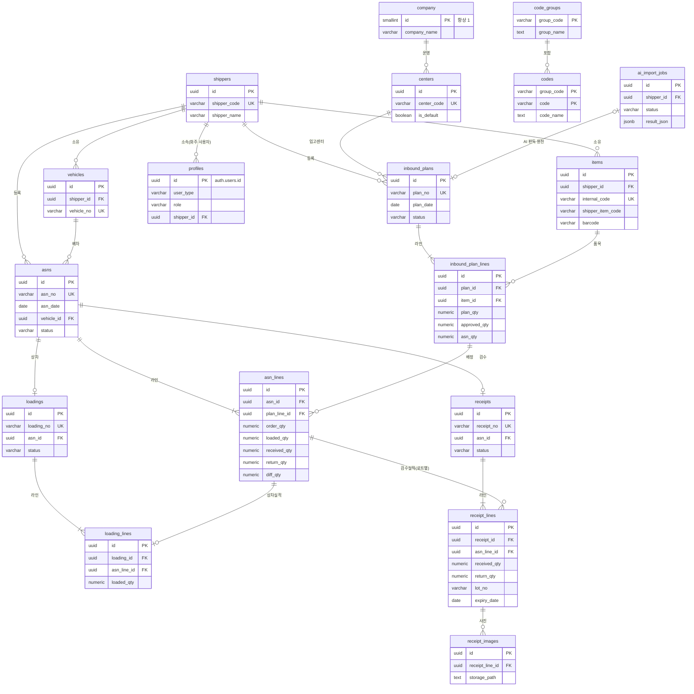

# 03. ERD와 테이블 정의

> DB는 Supabase PostgreSQL을 사용하며, 스키마는 `public`입니다. 실제 정의는 `supabase/migrations/`의 SQL이 기준이고, 이 문서는 그 요약입니다.

## 1. ERD

## 2. 공통 규칙

| 항목 | 규칙 |
|---|---|
| PK | `uuid` (`gen_random_uuid()`). 예외: `company.id`(1 고정), 공통코드(자연키) |
| 감사 컬럼 | 모든 테이블에 `created_at`, `created_by`, `updated_at`, `updated_by`. 트리거 `fn_set_audit`가 자동으로 채움 |
| 사용여부 | 기준정보는 삭제 대신 `is_active = false`를 권장. 전표가 참조 중이면 FK로 삭제를 막음 |
| 수량 | `numeric(15,3)`, 0 이상 CHECK |
| 코드 참조 | 공통코드 값 컬럼은 `*_code`로 이름 짓고, 유효성은 트리거 `fn_check_code(그룹)`로 검사 |
| 상태 | `varchar` + CHECK 제약. 변경은 RPC에서만 가능(`fn_guard_status`) |

## 3. 테이블 정의

### 3.1 기준정보

**company** — 3PL 회사정보 (1행)
| 컬럼 | 타입 | 제약 | 설명 |
|---|---|---|---|
| id | smallint | PK, CHECK(id=1) | 1행만 허용 |
| company_name | varchar(100) | NOT NULL | 상호 |
| biz_no | varchar(12) | | 사업자등록번호 |
| ceo_name | varchar(50) | | 대표자 |
| address | text | | 주소 |
| tel | varchar(20) | | 대표전화 |
| email | varchar(100) | | 대표 이메일 |

**shippers** — 화주사
| 컬럼 | 타입 | 제약 | 설명 |
|---|---|---|---|
| id | uuid | PK | |
| shipper_code | varchar(20) | UK, NOT NULL | 화주코드 |
| shipper_name | varchar(100) | NOT NULL | 화주명 |
| biz_no | varchar(12) | | 사업자번호 |
| address | text | | |
| manager_name / manager_tel / manager_email | varchar | | 업무 담당자(선택) |
| remark | text | | |
| is_active | boolean | default true | |

**centers** — 센터(창고)
| 컬럼 | 타입 | 제약 | 설명 |
|---|---|---|---|
| id | uuid | PK | |
| center_code | varchar(20) | UK | 센터코드 |
| center_name | varchar(100) | NOT NULL | |
| address / tel | | | |
| is_default | boolean | 부분 UK(true는 1건) | 기본 센터 |
| is_active | boolean | | |

**items** — 품목
| 컬럼 | 타입 | 제약 | 설명 |
|---|---|---|---|
| id | uuid | PK | |
| shipper_id | uuid | FK shippers, NOT NULL | 소유 화주 |
| internal_code | varchar(20) | UK, 기본값 자동채번 `IT0000001` | 3PL 내부코드 |
| shipper_item_code | varchar(50) | UK(shipper_id, shipper_item_code) | 화주사 품목코드 |
| item_name | varchar(200) | NOT NULL | |
| spec | varchar(200) | | 규격 |
| barcode | varchar(50) | UK(shipper_id, barcode) | 품목 바코드 |
| uom_code | varchar(20) | 공통코드 UOM | 단위 |
| box_qty | integer | > 0 | 입수량 |
| lot_yn / expiry_yn | boolean | default false | 로트·유통기한 관리 여부 |
| remark, is_active | | | |

**vehicles** — 차량
| 컬럼 | 타입 | 제약 | 설명 |
|---|---|---|---|
| id | uuid | PK | |
| shipper_id | uuid | FK shippers | 소속 화주 |
| vehicle_no | varchar(20) | UK | 차량번호 |
| vehicle_type_code | varchar(20) | 공통코드 VEHICLE_TYPE | 차종 |
| tonnage | numeric(5,1) | | 톤수 |
| driver_name / driver_tel | varchar | | 기사 정보(선택) |
| remark, is_active | | | |

**code_groups / codes** — 공통코드 (2단계)
| 테이블 | 컬럼 | 설명 |
|---|---|---|
| code_groups | group_code (PK), group_name, description, sort_order, is_system, is_active | 유형코드. `is_system`이 true면 삭제 불가 |
| codes | group_code + code (PK), code_name, sort_order, attr1, attr2, attr3, is_active | 공통코드 |

**profiles** — 사용자 (Supabase Auth `auth.users`와 1:1)
| 컬럼 | 타입 | 제약 | 설명 |
|---|---|---|---|
| id | uuid | PK, FK auth.users | |
| login_id | varchar(100) | UK | 로그인 이메일 |
| user_name | varchar(50) | NOT NULL | |
| user_type | varchar(10) | INTERNAL / SHIPPER | 사용자 구분 |
| role | varchar(20) | 아래 CHECK | 권한 |
| shipper_id | uuid | FK shippers | 화주 사용자 소속 |
| tel | varchar(20) | | 선택 |
| is_active | boolean | | 로그인 허용 여부 |

CHECK 규칙은 구분에 따라 다릅니다.
- INTERNAL: role은 ADMIN, OPERATOR, WORKER 중 하나이고 shipper_id는 비어 있어야 합니다.
- SHIPPER: role은 SHIPPER_USER이고 shipper_id가 반드시 있어야 합니다.

### 3.2 입고 전표

**inbound_plans / inbound_plan_lines** — 입고예정
| 테이블 | 주요 컬럼 |
|---|---|
| inbound_plans | plan_no(UK), shipper_id, center_id, plan_date, source_type(MANUAL/EXCEL/AI), ai_job_id, status, approved_by, approved_at, reject_reason, remark |
| inbound_plan_lines | plan_id, line_no(UK in plan), item_id, plan_qty(>0), approved_qty, asn_qty(자동 집계, ≤ approved_qty), remark |

**asns / asn_lines** — ASN·상차지시서
| 테이블 | 주요 컬럼 |
|---|---|
| asns | asn_no(UK, 바코드), shipper_id, center_id, asn_date, vehicle_id, vehicle_no(스냅샷), status, remark |
| asn_lines | asn_id, line_no, plan_line_id, item_id, order_qty(>0), loaded_qty, received_qty, return_qty, diff_qty(계산 컬럼) |

**loadings / loading_lines** — 상차
| 테이블 | 주요 컬럼 |
|---|---|
| loadings | loading_no(UK), asn_id(UK), status, worker_id, started_at, completed_at |
| loading_lines | loading_id, asn_line_id(UK in loading), item_id, scanned_barcode, loaded_qty |

**receipts / receipt_lines / receipt_images** — 검수·입고
| 테이블 | 주요 컬럼 |
|---|---|
| receipts | receipt_no(UK), asn_id(UK), shipper_id, center_id, receipt_date, status, worker_id, started_at, completed_at |
| receipt_lines | receipt_id, asn_line_id, item_id, scanned_barcode, result_code(INSPECT_RESULT), return_reason_code(RETURN_REASON), received_qty, return_qty, lot_no, expiry_date, remark |
| receipt_images | receipt_line_id, storage_path(Storage 버킷 `receipt-images`), file_name |

수량 불일치는 따로 수량을 입력하지 않습니다. `asn_lines.diff_qty`(상차 − 입고 − 반송)로 자동 계산합니다. 로트가 여러 개인 품목은 같은 ASN 라인에 대해 검수 라인을 여러 건 만듭니다.

### 3.3 기타
| 테이블 | 주요 컬럼 | 설명 |
|---|---|---|
| ai_import_jobs | shipper_id, image_path, status(PENDING/DONE/FAILED/APPLIED), raw_text, result_json, error_message, plan_id | 이미지 AI 판독 작업 |
| doc_sequences | prefix + seq_date (PK), last_no | 전표 채번 |

## 4. 이력 테이블 규칙

| 항목 | 내용 |
|---|---|
| 대상 | 기준정보·전표·AI 판독 테이블 전체 (`doc_sequences` 제외) |
| 이름 | `<원본 테이블>_hist` (예: `items_hist`) |
| 구조 | 원본 컬럼 전체 + `hist_op`(I/U/D) + `hist_by`(변경자 uuid) + `hist_at`(변경일시) + `hist_id`(bigint identity) |
| 적재 | 공통 트리거 `fn_write_history()`가 AFTER INSERT/UPDATE/DELETE 때 변경 후(삭제는 변경 전) 행을 저장 |
| 설정 | `select fn_enable_history('items');` 한 줄로 이력 테이블과 트리거를 생성 |
| 권한 | 이력 테이블은 조회 전용이며, 내부 사용자만 조회 가능 |
| 주의 | 원본 테이블에 컬럼을 추가하면 같은 마이그레이션에서 `_hist`에도 같은 컬럼을 추가해야 함(hist 컬럼 앞에 위치) |
